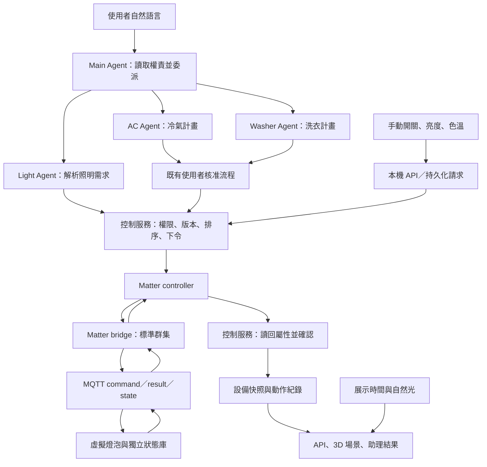

# 智慧燈泡與 Agent 權責實作計畫

日期：2026-10-20（Asia/Taipei）。狀態：首版實作與自動驗收已完成；日夜自動規則保留到下一階段。領域／API／前端／Light Agent 有回歸測試，真實 MQTT 與 Matter 配對、三群集、斷線及重啟已完成端到端驗收。測試證據見 [智慧燈泡測試與驗收](SMART_BULB_TEST_PLAN.md)。

本次已確認：首版先提供手動與自然語言控制；日夜自動規則放到下一階段。沿用目前 Python、React Three Fiber、MQTT、Node Matter controller／bridge，先控制一台虛擬客廳燈泡 `bulb-1`。

## 1. 首版目標與完成條件

| 情境 | 預期行為 |
| --- | --- |
| 白天 12:00、燈泡已關閉 | 日光照亮客廳，家具清楚可見；燈泡沒有發光。這個關燈狀態由使用者設定或測試初始化，不由展示時間自動產生。 |
| 晚上 21:00、燈泡仍關閉 | 太陽光為零，客廳明顯變暗；保留最低環境光，仍可辨識空間。 |
| 21:00 說「幫我把客廳燈調到 40%」 | Main 委派 Light Agent，控制服務執行，收到設備確認後顯示開啟、40%；在預設 2700K 的初始條件下呈現暖色照明。 |
| 說「改成暖色 2700K」或「調到 6500K」 | 透過 Color Control 改變色溫，面板與 3D 光源依確認回報同步。 |
| 重新整理或開第二個頁面 | 讀取同一份後端設備狀態，不恢復成前端預設開燈。 |
| Matter 或 MQTT 斷線 | 顯示失聯／回報過期與最後確認值，不能宣告指令已成功。 |

首版能力：開／關、亮度 0–100%、標稱色溫 2700–6500K、有限時間的漸變、狀態保存與查詢、自然語言控制、權責檢查及操作紀錄。Color Control 首版採 Color Temperature 功能；RGB、Hue／Saturation、彩色場景列為後續擴充。

## 2. Agent 權責：固定合約、執行時發現、程式強制檢查

權責由程式中的能力登錄表定義，Agent 啟動及處理需求時讀取。Main 可說明目前每個 Agent 的職責並選擇委派對象；模型不能替自己或其他 Agent 增加工具、設備權限或核准範圍。

| 角色 | 負責事項 | 可使用的工具與權限 | 明確限制 |
| --- | --- | --- | --- |
| Main Agent | 理解需求、讀取設備能力與權責、拆解跨設備需求、委派、彙整各設備結果 | `get_home_state`、`get_agent_roles`、`delegate_tasks` | 不直接控制設備、不自行核准、不改寫使用者指定條件、不把已入列描述成已完成。 |
| Light Agent | 僅處理 `bulb-1` 的照明意圖，讀取狀態、解析亮度／色溫、建立動作、查核結果 | `get_light_context`、`submit_light_action`，並透過 durable action／assistant feedback 取得進度與結果 | 不控制冷氣／洗衣機、不建立日夜自動規則、不修改權限、不呼叫 MQTT 或 Matter、不再次委派。 |
| AC Agent | 冷氣舒適需求、時段、目標溫度、計畫與估算 | 沿用冷氣查詢、規劃、驗證與提案工具 | 只限 `ac-1`；計畫仍須既有核准流程；不因燈泡可立即控制而取得直接開機權限。 |
| Washer Agent | 洗衣期限、安靜時段、合法排程、費用與計畫 | 沿用洗衣查詢、排程、驗證、提案與範圍內改排工具 | 只限 `washer-1`；保留核准與中止確認；不得控制燈泡或冷氣。 |

以下元件使用確定性程式，不另建 LLM Agent：

| 元件 | 權責 |
| --- | --- |
| 控制服務與權限檢查 | 檢查動作來源、設備範圍、能力、數值、版本與期限，排序並下令；依回報判定成功、部分完成或未知。 |
| Matter controller／bridge | 執行標準群集命令、驗證與轉送上下文、同步狀態；不理解自然語言、不制定照明策略。 |
| 虛擬燈泡 | 保存並執行開關／亮度／色溫及漸變，產生狀態、結果與序號，是模擬設備實際狀態的來源。 |
| 場景環境／3D 畫面 | 計算自然光、顯示設備回報與操作入口；展示時間沒有設備控制權限。 |

能力登錄表至少包含 `role`、`device_ids`、`tools`、`capabilities`、`execution_policy` 與版本。為避免 Python／Node 分別維護不同設備清單，新增共用的 `config/device_capabilities.json`，由兩側驗證後載入；Python 的 `agent_roles.py` 定義工具處理函式及角色授權，並與設備能力交叉驗證。設備未提供的功能不出現在 Agent 可用工具中。

Main 的兩台設備限制改為依登錄表檢查，首版可拆成冷氣、洗衣機、燈泡三個子工作，每台最多一份。沿用既有共用模型預算與單層委派，逐設備保留成功／失敗／處理中；某台失敗不撤銷其他已確認的動作。

## 3. 控制、回報與權限流程

此圖為 Matter 模式。MQTT 模式可直接由控制服務連接 MQTT，供開發與獨立驗收；傳輸模式在啟動時明確選定。Matter 模式失聯時維持失敗／未知，不自動繞過 Matter。

明確的手動操作或「幫我把客廳燈調到 40%」可作為該次立即照明動作的授權，不再要求一張排程核准卡。控制服務從已保存的原始請求建立執行授權；模型不能自填 `approved=true` 或把建議、設備資料、歷史對話當成新授權。`prepare_light_action` 的產物必須原樣提交，服務檢查其是否符合這次請求與允許的偏好補值。語意、設備或相互矛盾的數值不明時才補問。

Agent 工具仍不直接連設備。將來新增排程／自動化需要另一份明確授權，不由本次立即調光指令推導。冷氣與洗衣機繼續使用各自既有的核准規則。

## 4. 操作語意與預設值

| 輸入／操作 | 首版定義 |
| --- | --- |
| 全新模擬設備 | 預設關閉，保存亮度 100%、暖白 2700K；之後依設備持久化狀態恢復。 |
| 「開燈」 | 開啟，使用上次非零亮度及目前色溫；不存在歷史值才使用預設。 |
| 「關燈」 | 關閉，保留上次非零亮度與色溫。 |
| 「調到 40%」 | 設為開啟、亮度 40%；保留目前色溫。範例暖光來自預設／先前的 2700K，不因夜晚強制覆蓋色溫。 |
| 亮度 0% | 轉為關閉；不把儲存的上次非零亮度清掉。 |
| 「暖色」／「冷白」 | 分別對應偏好中的 2700K／6500K；完整數字指令優先。 |
| 僅修改色溫 | 更新色溫，保留目前開關；燈原先關閉就保持關閉。 |
| 漸變 | 預設 0.5 秒，可指定 0–10 秒；計時採真實經過時間，不隨場景加速。 |
| 超出能力範圍、NaN、無窮值、矛盾參數 | 回報限制，不默默改成另一個值。 |

場景沿用 06:00 日出、18:00 日落的風格化模型。白天與夜晚的比較使用同一視角、材質與固定曝光，避免自動曝光消除明暗差異。自然光強度與燈泡光源獨立計算；燈泡光源強度依回報亮度映射，色溫映射為光色，燈泡材質同步發光。40% 為設備亮度設定，不宣稱是物理照度或畫面像素亮度的 40%。

目前前端真實／手動／120 秒循環時間仍只供視覺展示，不改設備排程時鐘，也不觸發燈泡。首版不回報虛構的照度感測值。

## 5. 狀態、命令與資料保存

新增燈泡專用 `BulbState`、`BulbCommand`、`BulbResult`，不把洗衣機的行程、進度與啟停限制套到燈泡。燈泡協議與既有家電協議分別識別版本，舊冷氣／洗衣機訊息維持相容。

| 資料 | 必要內容 |
| --- | --- |
| `BulbState` | 設備 ID、協議版本、boot ID、sequence、真實 observed_at、state_version、power、current_level、color_temperature_mireds、目前漸變目標／進度、last_command_id、action_id、故障資訊。 |
| `BulbCommand` | action_id、command_id、設備、動作／目標欄位、expected_boot、expected_state_version、generation、issued_at、expires_at、授權來源參照、協議版本。 |
| `BulbResult` | command_id、action_id、accepted、拒絕原因、boot ID、回報版本；accepted 僅代表受理。 |
| 動作紀錄 | 原始需求、來源與角色、目標、子步驟、排入／送出／受理／確認時間、結果、關聯設備版本與 Agent 工具紀錄。 |

`current_level` 與 mired 為通訊標準值；API 額外提供四捨五入的亮度百分比、有效亮度與標稱 Kelvin。關閉時有效亮度為 0，儲存亮度仍可非零。`sequence` 用於每次回報排序；`state_version` 用於目標／設定變更，不能因每秒心跳就讓所有使用者請求過期。

控制端 SQLite 新增燈泡動作與授權參照資料；共用 `devices`、`samples`、`commands` 與 audit 紀錄。虛擬燈泡使用獨立 `HEMS_BULB_DB`，由設備保存狀態與命令去重。資料遷移升至 v3，修正目前初始化固定寫入 v2 的方式，依既有版本循序遷移，保留原任務、歷史、WAL 與 Matter 配對資料。

燈泡動作不用冷氣／洗衣機的「每設備一個未結束排程任務」資料模型；另外管理短動作的生命週期：`queued → dispatched → accepted → confirmed`，並允許 `rejected`、`partial`、`unknown`、`superseded`。立即照明不先要求住宅費率與月份基準；首版不新增燈泡用電／電費模型。

## 6. MQTT 與 Matter 對應

沿用 `home/hems/devices/bulb-1/command`、`result`、`state`。命令 QoS 1、不 retained；結果 QoS 1、不 retained；狀態保留最新快照並定期發布。每次有效變更立即回報，背景約每秒心跳。狀態新鮮度使用真實 UTC 時間與單調時鐘，不使用展示時刻判斷。

Matter 沿用鎖定的 `@matter/main@0.17.9`，在現有 aggregator 下新增 `bulb-1`、endpoint 4，保留洗衣機 endpoint 2、冷氣 endpoint 3。使用本機依賴已有的 `ColorTemperatureLightDevice`；其定義已包含 OnOff、LevelControl、ColorControl 的 ColorTemperature 功能與必要輔助行為。

| 能力 | Matter 操作 | 同步要求 |
| --- | --- | --- |
| 開／關 | `OnOff.On`、`OnOff.Off` | 讀回 `OnOff`；Agent 與重試一律使用明確目標，避免 Toggle 的非冪等效果。 |
| 亮度 | `LevelControl.MoveToLevelWithOnOff` 等標準命令 | 讀回 `CurrentLevel`、`OnOff`；前端 0% 在服務層轉為 Off。 |
| 色溫 | `ColorControl.MoveToColorTemperature` | 讀回 `ColorTemperatureMireds`、`ColorMode`；在燈關閉時設定需明確處理 ExecuteIfOff，避免命令被忽略。 |
| 漸變 | 將秒數轉為對應命令的時間單位 | 實際進度由虛擬設備回報，不讓 bridge 與設備各自跑一份獨立的漸變模型。 |

亮燈狀態的 Level 使用設備宣告的範圍（目前定義為 1–254）；40% 映射約為 102。色溫使用 `mired = round(1,000,000 / Kelvin)`，宣告實際可表示的物理界線，Kelvin 上下界量化後約為 154–370 mired。以標準值及合理量化誤差查核，不能要求轉換後 Kelvin／百分比逐字相等。上述命令與功能分工亦見 [Matter 官方照明範例](https://project-chip.github.io/connectedhomeip-doc/examples/lighting-app/telink/MULTI_ENDPOINT_IDENTIFY.html)；Level 操作參考 [官方 CHIP Tool 指南](https://project-chip.github.io/connectedhomeip-doc/development_controllers/chip-tool/chip_tool_guide.html)。

bridge 只把設備回報投影到標準屬性，遙測更新不得再次發布控制命令。保留 HemsTask 作為專案的請求上下文與關聯資訊，但 controller 必須真正讀回三個標準群集的相關屬性，與設備回報及命令識別碼核對，不能只讀專案 JSON 快照就宣稱標準功能已驗證。

為避免底層預設行為繞過檢查，新增燈泡 behavior 需檢查所有會改動開關／亮度／色溫的入口；未提供的操作明確拒絕。必要輔助群集沿用 SDK 定義並驗證，不宣稱已完成 Matter 認證或第三方控制器互通。

## 7. 多欄位操作、競爭、斷線與重啟

「開啟、40%、2700K」是一份應用動作，Matter 會有多個標準群集操作，不能假設跨群集原子完成。控制服務保存每個子步驟，使用共同 action_id、各自固定 command_id，先準備色溫，再調光／開啟；關閉狀態下的色溫準備不得先亮燈。每個步驟僅能修改其上下文允許的欄位，bridge 與設備都檢查。

只有全部必要欄位在漸變完成後由新鮮回報確認，且標準屬性一致，動作才是 confirmed。中途失敗記錄實際已變更的欄位並回讀，回報 partial 或 unknown；不假裝全部成功、不自行回滾成另一個使用者未要求的照明狀態。

- 相同 command_id／相同內容回傳持久化結果；相同 ID 不同內容拒絕。HTTP 重送沿用 request_id，不能重複執行。
- 每台燈泡的變更串行處理；新明確操作可替代尚未完成的舊目標。用 generation 阻止被替代的舊動作繼續送出後續步驟，慢到的 Agent 提案須重新查核版本。
- 滑桿拖曳在前端預覽待送值，放開或短暫停止後才提交；主要設備值與 3D 場景仍使用確認回報。顯示「調整中」，不把樂觀預覽當成完成。
- 命令有效期先採真實時間 10 秒，確認期限依 transition 時間加上回報餘裕設定；期限內重送只能沿用同一 ID 與原始期限。
- 超過 10 秒未有新鮮狀態即標示過期；保留最後確認值與過期提示，不推定燈泡已關閉。恢復後先查詢，不補送過期命令。
- 模擬器在通訊中斷時繼續已接受的漸變並保存狀態；程序重啟時恢復最後持久化的實際值，取消尚未完成的漸變並回報 interrupted，不推測重啟期間完成了動作。
- Matter controller／bridge 重啟保留 fabric 與 endpoint 身分，重新讀取狀態；不得重播舊開燈命令或降級直連 MQTT。

## 8. 分階段交付與檔案範圍

依序交付，每階段有可獨立檢查的結果；A、B、C、D 全部完成才算本次首版完成。

| 階段 | 實作範圍 | 主要檔案 | 完成門檻 |
| --- | --- | --- | --- |
| A：能力合約與虛擬設備 | 權責／設備登錄表、燈泡資料型別、版本化遷移、持久化動作、MQTT 模擬器、序號與去重 | 新增 `config/device_capabilities.json`、`agent_roles.py`、`bulb_domain.py`、`bulb.py`、`bulb_control.py`；調整 `repository.py`、訊息編解碼及啟停腳本 | 隔離 Broker 上可開關、調光、調色溫；重送／過期／非法數值不產生錯誤動作；狀態可恢復。 |
| B：Matter 完整控制與讀回 | endpoint 4、三群集操作、步驟上下文與 partial、標準屬性讀回、失聯判定與復原 | `matter/bridge.mjs`、`controller.mjs`、`common.mjs`、`matter_transport.py` | 真實 Matter controller／bridge 完成開關、40%、2700K／6500K，並驗證標準屬性；橋接中斷不繞路。 |
| C：手動面板與 3D 回報同步 | 燈泡 API、動作查詢、亮度／色溫面板、移除本頁 lightOn 狀態、色溫／亮度光源映射、夜間校準 | `api.py`、`web/src/types.ts`、`api.ts`、`App.tsx`、`DevicePanel.tsx`、`Scene.tsx`、`dayNight.ts` | 12:00 關燈、21:00 關燈、21:00 暖光 40% 三場景通過；重新整理與第二頁面狀態一致。 |
| D：Light Agent 與跨設備協調 | Light 專用工具、角色能力查詢、三設備委派、立即動作授權、非同步進度與最終結果、助理顯示 | 新增 `light_agent.py`；調整 `multi_agent.py`、`control.py`、`assistant_ui.py`、偏好設定與相關畫面 | 自然語言案例經 Matter 執行並回讀；越權被程式拒絕；冷氣／洗衣核准流程回歸通過。 |
| E：後續自動規則 | 時間／環境條件、規則授權、手動優先、暫停與覆寫 | 另立規則與環境服務設計 | 不納入本次首版。 |

新增編解碼採登錄方式替換散落的 `if ac else washer`；共用傳輸介面維持簡單，不另建通用工作流平台。API 請求仍走持久化佇列，讀取端沿用現有輪詢；本次不因燈泡加入額外即時通訊框架。

## 9. 驗收案例與證據

| 類型 | 必要案例 |
| --- | --- |
| 領域與協議 | 0／1／40／100%、非法值、Kelvin／mired 量化、關燈保存亮度、色溫修改不意外開燈、漸變中替代、重啟中斷、去重與 ID 衝突。 |
| API／狀態 | request_id 重送、版本衝突、boot 變更、舊序號忽略、accepted 與 confirmed 分離、雙頁同步、斷線及 stale 顯示。 |
| MQTT 整合 | 真實隔離 Broker、設備程序與控制服務；開關／調光／調色溫、斷線續行、恢復讀取、過期命令不重播。 |
| Matter 整合 | 實際配對、endpoint 4 的三群集命令與標準屬性、MQTT／Matter／API 一致、ExecuteIfOff、回報不產生命令迴圈、多步部分失敗、bridge 停止不退回 MQTT。 |
| Agent 權責 | Main 只能查詢與委派；Light 控制其他設備被拒絕；偽造授權欄位、沒有原始請求的提交、越界目標被拒絕；Agent 可正確回答每個角色的職責。 |
| 自然語言 | 「客廳燈 40%」「關燈」「調成暖色」「只改成 6500K」；「開冷氣、安排洗衣，燈調到 40%」分成三項，燈立即執行、其餘待各自核准；模型不可用仍可手動控制。 |
| 畫面 | 固定視角／曝光下的 12:00 關燈、21:00 關燈、21:00 40%／2700K 截圖；手機與桌面操作；切換展示時間不送設備命令。 |
| 原功能回歸 | 現有前端互動、Streamlit、冷氣與洗衣排程／核准、兩種傳輸及既有配對保存。 |

一般測試使用假模型、暫存資料庫與隔離 MQTT 主題，不呼叫付費服務；真實模型使用另行啟用的驗收。整合驗收保存每步命令、設備回報、Matter 標準屬性與結果至獨立 artifacts 目錄。不得把既有冷氣／洗衣機 Matter 驗收記為燈泡驗收。

## 10. 下一階段的日夜自動規則邊界

使用者另行啟用規則後，再支援例如「白天關燈、晚上有人時暖光 40%」。時間／環境資料由後端提供來源、時區與有效性；目前前端展示時間不能直接觸發真實或共用設備。若需要加速自動化展示，另建明確標示、所有頁面共用的後端模擬環境時鐘，與既有家電排程時鐘分開。

優先序預定為：明確手動／語言操作優先於自動規則。使用者覆寫後須有可見的暫停期限／恢復方式，避免規則下一次檢查立即把燈改回去。規則由控制服務評估，不每秒呼叫模型；Light Agent 可解釋規則、提出設定，但不能自行啟用。

## 11. 盤點依據與已知實作缺口

- `web/src/App.tsx` 目前以 `useState(true)` 管理燈泡，`DevicePanel.tsx` 只切換此狀態；`Scene.tsx` 的 Lamp 只有布林開關與固定暖光。
- `api.py` 的設備快照、`multi_agent.py` 的委派白名單及 `MatterHub` 佇列目前都只有 `ac-1`、`washer-1`。
- `washer.py` 的命令／結果／狀態驗證只接受兩台現有設備，MQTT 解碼採冷氣／洗衣分支；燈泡需要獨立型別與路由。
- `matter/bridge.mjs` 只接受 query／reset／start／stop，controller 只配置 endpoint 2、3；目前 Hems 快照讀取也需要擴充成標準燈光屬性查核。
- 本機安裝的 `@matter/main` 版本為 0.17.9；已核對 `@matter/node/src/devices/color-temperature-light.ts`、LevelControlServer 與 ColorControlServer 的型別及定義。規劃不依賴升級套件。
- 已通過 Python、前端、真實 Broker 與 Matter controller／bridge 驗收；自動化報告位於 `artifacts/phase2-mqtt-smoke.json` 與 `artifacts/phase2-matter-smoke.json`。
